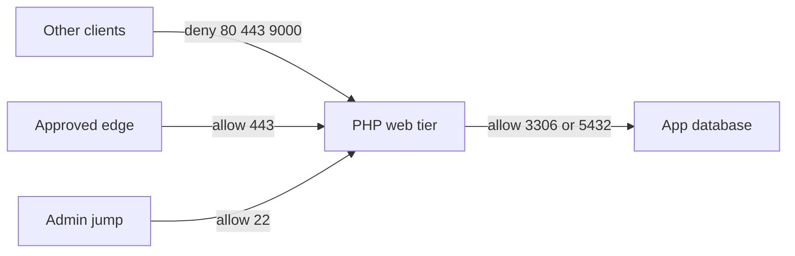

# Contain PHP workloads until they are patched

Finding the package does not change who can reach it. The containment step is a small allow-list on those hosts while the PHP update is scheduled.

This is reachability. It is not a patch, a virtual patch, or detection of CVE-2026-109618 or CVE-2026-109619. Secure Firewall CVE-to-IPS was not checked for these CVE ids. Live Protect for applications is a later agent and is not what this example uses.

## Order of work

1. Find the hosts with the package filter or `find_workloads_by_package`.
2. Put them in a lab workspace first. Confirm the consumer and the provider with a flow search before you publish.
3. Add the allows below.
4. Add the deny for other clients to the PHP web ports, or set the workspace catch-all to Deny.
5. Publish in the lab. Confirm an unapproved client is dropped and the approved front door still works.
6. Upgrade PHP, or install the vendor backport. Refresh inventory. Search the package again and confirm the new version.

Do not flip a production workspace to enforce from this page.

## What to allow

Use synthetic filter names. Replace them with the filters on your tenant. `l4_params.port` is a closed range `[low, high]`. Protocol `6` is TCP. That shape was read from a Secure Workload SaaS tenant on 22 Oct 2026.

| Policy | Action | Consumer | Provider | Port |
|---|---|---|---|---|
| Front door | ALLOW | Approved edge or reverse proxy | PHP web tier | TCP 443 |
| Application data | ALLOW | PHP web tier | That app’s database | TCP 3306 or 5432, whichever it uses |
| Administration | ALLOW | Admin jump host | PHP web tier | TCP 22, if shell access is still required |
| Everyone else | DENY | Any other consumer in the scope | PHP web tier | TCP 80, 443, and 9000 |

PHP-FPM on TCP 9000 should be allowed only from the web server on the same host or the approved proxy, not from the rest of the network.

The full example is [examples/sample-policies.json](../examples/sample-policies.json). It was not posted to an API.

## What containment changes

An unapproved address cannot open a new TCP connection to those ports when the agent is enforcing and the policy is the one published on that host.

The approved edge can still forward the HTTP request. If that path is open, the PHP bug is still reachable. Segmentation does not stop code that is already running on the host, and it does not cover a listener that this policy forgot.

## What the PHP project says to do if you cannot update today

Quoted from the [21 Oct 2026 advisory](https://www.php.net/archive/2026.php#2026-10-21-5). These are PHP settings, not Secure Workload features. The same advisory says they reduce exposure to specific attack paths and do not make an installation safe. The release notes say there are no complete mitigations and updating is the only safe choice.

For CVE-2026-109618: `memory_limit=-1` in a way the application cannot override, a low `post_max_size`, and a container or cgroup limit that kills only the affected worker.

For CVE-2026-109619: `session.upload_progress.enabled=0` in `php.ini` or the FPM pool, then restart every worker. On PHP 8.5, `fatal_error_backtraces=0`.

Highest stated risk is mod_php, including a demonstrated case where the request triggers the bug before application code runs. PHP-FPM, php-cgi, FrankenPHP, and LiteSpeed are in scope too.

## After the patch

Search `php` again. The host drops out of the vulnerable filter when the reported version is a fixed build, or a vendor package you have confirmed contains the backport. Publishing the allow-list does not clear the filter.
