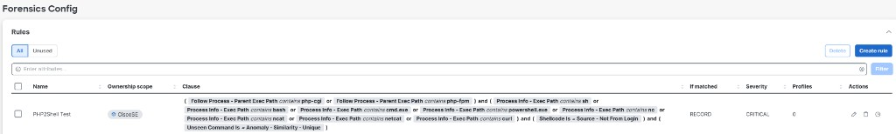

# Forensic rule: PHP Suspicious Behavior

Thanks to **Jeremy Hagerman** (Commercial Central SE) for contributing this forensic rule, and to **Mike Delaguardia** for helping make it available to the field.

The rule looks for a small set of IOCs in the PHP process tree: `php-cgi` or `php-fpm` starting a shell or a script interpreter. That is the pattern you get when someone is using the PHP worker as a launch pad. It is **not** a detector for CVE-2026-109618 or CVE-2026-109619, and it is not a virtual patch. Updating PHP is still the only complete fix. Segmentation still does the reachability cut in [contain-until-patched.md](contain-until-patched.md).

It does not fire unless **Forensics is enabled on the agent config intent** that covers the host. Adding the rule to Forensic Config is not enough.

## What to look for in the tenant

In **Forensics Config**, the published name to search for is **PHP Suspicious Behavior**. The lab row that was captured on 23 Oct 2026 was named `PHP2Pwnltest`, owned under `CloseSE`.

| Field | Value on the captured row |
|---|---|
| Name | `PHP2Pwnltest` (search the tenant for **PHP Suspicious Behavior**) |
| Ownership | CloseSE |
| If matched | RECORD |
| Severity | CRITICAL |
| Profile tiles | 0 on that day — bind it to a forensic profile, then an intent |



## Match (reconstructed from that row)

The UI clause was captured from the screenshot. Confirm it in your tenant before you copy it.

```text
(
  Process Info - ParentExecPath contains php-cgi
  OR Follow Process - ParentExecPath contains php-fpm
)
AND (
  Process Info - ExecPath contains sh
  OR Process Info - ExecPath contains bash
  OR Process Info - ExecPath contains cmd.exe
  OR Process Info - ExecPath contains powershell.exe
  OR Process Info - ExecPath contains py
)
AND Source - Not Login
AND Unseen Command is Anomaly - Similarity - Unique
```

In plain language: a PHP parent (`php-cgi` or `php-fpm`) started `sh`, `bash`, `cmd.exe`, `powershell.exe`, or a `py*` binary, the event was not a login shell, and the command looked unique against the unseen-command baseline.

That is a useful tripwire for someone messing around in the PHP layer. It will miss a payload that never leaves the PHP process, and it can fire on a rare but legitimate helper that PHP is allowed to start.

## How to apply it

1. Create or import the rule under Forensic Config.
2. Add it to a forensic profile.
3. Bind that profile with a forensic intent to the agent group that includes the PHP hosts (or the lab set you want to watch).
4. On the **agent config** that those hosts use, turn **Forensics** on. Jeremy’s note: he applied the rule to anything in the lab, and it does not work unless Forensics is enabled on the config intent.
5. After PHP-cgi or PHP-FPM starts a shell, look for a RECORD event at CRITICAL. There is no enforcement action in this rule — it records. Containment is still the allow-list in [contain-until-patched.md](contain-until-patched.md).

Package visibility and Forensics are different switches. The inventory filter in [find-with-csw.md](find-with-csw.md) needs package visibility. This rule needs Forensics.

## Limits

- Not a CVE match and not a virtual patch.
- Does not stop the child process. RECORD only on the captured row.
- Needs Forensics on the config intent, a profile, and an intent binding. Zero profile tiles means the rule exists and is not watching anyone yet.
- `ExecPath contains py` is broad. Review hits before you treat them as compromise.
- This page is a field capture, not an official Cisco signature pack.
